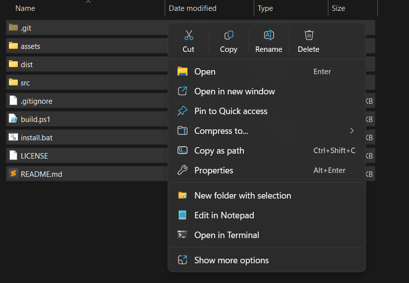

# New folder with selection

`NewFolderWithSelection` adds the **New folder with selection** action from macOS Finder to the Windows 10 and Windows 11 File Explorer right-click menu. It runs as a native C++ shell extension (`NewFolderWithSelection.dll`) with no background processes.



## Install from Releases

1. Download [`New-folder-with-selection.zip`](https://github.com/DeadFlamingo/New-folder-with-selection/releases/latest/download/New-folder-with-selection.zip) from the [latest release page](https://github.com/DeadFlamingo/New-folder-with-selection/releases/latest).
2. Right-click `New-folder-with-selection.zip`, select **Extract All...**, and extract the archive into any folder. Do not run `install.bat` directly from inside the unextracted `.zip` preview window.
3. Open the extracted folder and double-click `install.bat`.
4. If Windows SmartScreen shows a **Windows protected your PC** prompt, click **More info** and then click **Run anyway**.
5. In the setup window that opens, press `1` on your keyboard to install or update the extension:
   - Press `1` to **Install / Update**.
   - Press `2` to **Uninstall**.
   - Press `3` to **Exit**.
6. Once you see `Installed successfully`, press any key to close the window. The **New folder with selection** item is immediately available in File Explorer without restarting Windows.

You can also run `install.bat` silently from a terminal:

```cmd
install.bat --install
install.bat --uninstall
```

## Use

1. Select one or more files or folders in File Explorer.
2. Right-click the selection and click **New folder with selection**.
3. Type a name for the new folder and press `Enter`.

If you select a single file, the initial folder name defaults to the file name without its extension. If you select multiple items, the initial folder name defaults to `New Folder With Items`. If a folder with that name already exists, the extension appends ` 1`, ` 2`, and so on.

## Uninstall

Run `install.bat` and press `2`, or run `install.bat --uninstall` in a terminal.

## Build from source

Building from source requires Visual Studio 2022 with the Desktop development with C++ workload.

```powershell
.\build.ps1
```
